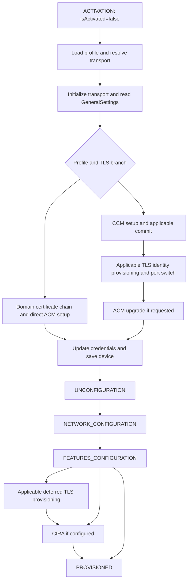

# Issue #2935: provisioning state-machine analysis

This analysis addresses [Optimize the RPS Provisioning State Machine](https://github.com/device-management-toolkit/rps/issues/2935). The source baseline is the September 21, 2026 release, **v2.40.2**, commit **583d61f0cd4ad080cac1baacdff5b1606d9079d3**. The analysis lives on `analysis/provisioning-state-machine`.

Only the release source is used to establish behavior. The local TLS-preservation patch, diagnostics implementation, existing activation cheat sheet, and captured diagnostics-build logs are excluded from the baseline. No provisioning behavior has been changed by this analysis. Predicted request savings below are derived from source transitions, not hardware measurements.

## Findings

Two guard-placement changes have strong source evidence: TLS-enforced cleanup reads TLS settings it never uses, and non-TLS reconfiguration probes TLS state before a routing guard that ignores the result. Start with those separately scoped changes. Evaluate certificate-context reuse and selective feature updates afterward. Do not remove cleanup wholesale based only on the device reporting pre-provisioning mode.

The [state and WS-Man inventory](provisioning-wsman-inventory.md) lists state actors, message builders, and direct transitions. It includes failure/retry targets; it does not represent a single execution sequence. `Enumerate` and `Pull` are separate requests. Multiple `Pull` requests, digest challenges, transport retries, and loops over distinct selectors must be counted separately in a runtime trace.

## Entry and first-time activation

`DataProcessor.activateDevice` validates the client request, sets connection parameters, and sends `ACTIVATION` or `ACTIVATED` according to `devices[clientId].activationStatus`. Reconfiguration therefore uses the activation machine with a different entry event; it is separate from the `MAINTENANCE` operations.

For first-time activation, `ACTIVATION` sets `isActivated=false`. The profile is loaded, then the optional legacy LMS routing evaluation runs. Its pre-provisioning and AMT 19+ checks preserve the appropriate transport rather than forcing a legacy non-TLS probe.

| Scenario | Port behavior and provisioning prerequisites |
|---|---|
| AMT 19+, TLS enforced | RPC starts on 16993. RPS initializes the TLS tunnel and validates factory trust before activation. CCM activation, commit/rollover, and certificate provisioning precede the applicable ACM upgrade. No initial 16992-to-16993 switch is required. |
| AMT 18 and below with `--tls-tunnel` | Starts on 16992, uses the CCM path, provisions TLS identity, signals RPC to switch to 16993, then continues over the tunnel and performs an ACM upgrade if the profile requires it. |
| AMT 18 and below without the tunnel flag | Starts on 16992. The applicable CCM or direct ACM path is selected by the profile. Subsequent TLS work depends on the release's profile/device guards; do not assume every legacy run switches ports. |
| ACM profile | Requires the configured domain provisioning certificate, trusted hash checks, certificate-chain injection, and signed nonce. Host-based setup/upgrade calls are one-shot; reconnect or timeout recovery checks activation state rather than blindly issuing setup again. |
| CCM profile | Does not require an ACM upgrade. The TLS and non-TLS branches still differ in commit, identity handling, and delays. |

The [TLS flow reference](https://github.com/device-management-toolkit/rpc-go/wiki/Activating-AMT-with-E2E-TLS-and-RPS) is orientation; version/profile guards and reachable transitions in this release remain the implementation evidence.

Typical successful first-time paths converge after activation, credential updates, and applicable TLS work:

This diagram groups conditional states. It does not imply every device visits CCM, TLS provisioning, upgrade, and CIRA.

## Reconfiguration

`ACTIVATED` sets `isActivated=true`. `CHECK_PROFILE_TYPE` first performs the tenant-access check. After transport initialization, `GET_GENERAL_SETTINGS`, and digest-realm validation, the machine enters `CHECK_AMT_TLS_STATE`.

| Existing device / requested operation | Release behavior |
|---|---|
| Non-TLS local routing selected | The release still invokes the TLS probe. The first `onDone` guard then selects `ROUTE_ACTIVATED_NON_TLS` irrespective of the probe result. This is candidate B below. Keep the earlier LMS transport-selection probe where applicable. |
| TLS enabled with credential context | Validate the live TLS certificate against the Vault leaf certificate. Reuse matching identity; mark missing/mismatched identity for provisioning. Preserve certificate verification. |
| TLS absent or incomplete | Mark TLS provisioning when the selected route requires it. Proceed through the applicable credential/upgrade path and provision identity before later TLS traffic. |
| CCM to ACM | `canUpgrade` selects host-based setup/upgrade and the provisioning certificate path. It is not ordinary ACM-to-ACM reconfiguration. |
| ACM to ACM or CCM to CCM | Use the applicable password/credential path. Reuse valid TLS where possible, then converge on cleanup, network, features, and optional CIRA. |
| Failed certificate/TLS probe | Preserve the existing fallback and error branches. A cache must never convert a failed probe into successful validation or force an unintended non-TLS route. |

Repeated host-based setup reads used after a commit, upgrade, or timeout verify changed device state. They are not interchangeable with the initial read.

## Shared configuration stages and ordering

The actual successful ordering after cleanup is:

1. Network general settings check; `Put AMT_GeneralSettings` only when the network flags require it.
2. `Enumerate`/`Pull AMT_EthernetPortSettings` to discover wired and wireless interfaces.
3. Wired configuration if supported. The release skips the wired Ethernet `Put` when TLS is enforced, then evaluates wired 802.1X. Otherwise it writes the applicable Ethernet settings. Wired 802.1X may obtain credentials/certificates from Enterprise Assistant, generate/sign a key, install certificates, update settings, and bind certificates according to the authentication protocol.
4. Wireless configuration if selected by interface/profile guards. This includes the retransmission setting, Wi-Fi service/synchronization settings, endpoint state, and profile loop. Enterprise wireless profiles have their own 802.1X/certificate path; local/UEFI synchronization and profile installation are distinct branches.
5. **CIRA proxy configuration** (`PROXY_CONFIGURATION`) inside the network machine when the profile supplies proxies. Each proxy is added with `IPS.HTTPProxyService.AddProxyAccessPoint`.
6. AMT features: redirection, KVM, and opt-in. Current values are read, then updates are conditional.
7. Applicable deferred TLS provisioning, followed by CIRA when configured.
8. CIRA: load configuration/password, add its trusted root, save secrets/register with MPS, add the MPS server, discover its reference, add periodic and user-initiated policies, update policy-to-MPS associations, enable the connection service, and update environment detection.

**Proxy configuration precedes the CIRA connection stage in this release.** The issue's orientation list must not be used to reorder these stages without dependency evidence. The wireless-only and unsupported-interface branches also need independent coverage; not every network path visits every child machine.

## Optimization candidates and evidence

Counts describe nominal request savings per applicable execution, excluding retries.

| Candidate | Applicable flow | Source evidence and proposed change | Predicted savings | Validation needed |
|---|---|---|---|---|
| **A: check TLS cleanup guard before reading settings** | First-time activation and reconfiguration once `tlsEnforced===true` | In `unconfiguration.ts`, both successful paths after MPS discovery/deletion enter `ENUMERATE_TLS_SETTING_DATA`, then `PULL_TLS_SETTING_DATA`. The first guard in `PULL_TLS_SETTING_DATA_RESPONSE` routes TLS-enforced devices straight to environment detection, before any settings/certificate cleanup uses the response. Move this guard ahead of both reads. | **2 requests** per cleanup invocation | Both paths with/without MPS entries; TLS and non-TLS; continued environment cleanup; existing MPS/environment failure handling; successful full provisioning and CIRA/proxy results. Failures of the discarded reads would cease to interrupt this path. |
| **B: route non-TLS reconfiguration before probing TLS state** | Reconfiguration with `isLmsNonTlsAllowed` or `shouldUseNonTlsActivatedPath` true | `checkAmtTlsState` reads TLS settings and, when enabled, credential contexts. The first `CHECK_AMT_TLS_STATE.onDone` guard ignores the result for a selected non-TLS route. The actor has no device-setting writes. Evaluate the same routing condition before invoking that actor; retain the earlier transport-selection probe. | **2 requests**, or **4** when the TLS-enabled result triggers a credential-context read | Legacy local non-TLS, explicit tunnel flag, AMT 19+ TLS routing, CCM-to-ACM and same-mode reconfiguration, failed probe behavior, digest authentication, and no loss of required later TLS provisioning. |
| C: reuse the successful TLS credential-context read during certificate validation | TLS reconfiguration with a stored leaf certificate | `checkAmtTlsState` reads credential contexts, then `getActiveTlsCertificateFingerprints` reads them again on the validation path. Carry the successful result within this activation attempt and use it only if no invalidating event occurs. Keep the public-certificate read and fingerprint verification. | Up to **2 requests** | Freshness/invalidation on writes, commit, rollover, failed reads, retries, reconnects, and new attempts; complete enumeration results; matching and mismatched identities. This remains conditional, not approved for removal. |
| D: separate feature-change guards | Either flow when only some feature settings change | A single `isRedirectionChanged` flag includes SOL, IDER, listener, and KVM changes. It triggers `SET_REDIRECTION_SERVICE → SET_KVM_REDIRECTION_SAP → PUT_REDIRECTION_SERVICE`. Thus a SOL-only change also requests KVM state even when KVM already matches. Consider a separate KVM-change guard while retaining listener/redirection dependencies. | Potentially **1 request** for a proven unchanged KVM state | Firmware semantics of `RequestStateChange`, enabled-but-offline state, enabling/disabling each feature independently, coupled listener behavior, opt-in, and failure propagation. Do not assume a repeated setter is harmless or unnecessary. |

Candidates A and B are the strongest starting points because they move existing decision conditions before results the selected branch discards. Candidates C and D require more conditions and evidence. Hardware validation remains necessary before shipping any candidate.

Pinned source evidence: [TLS cleanup](https://github.com/device-management-toolkit/rps/blob/583d61f0cd4ad080cac1baacdff5b1606d9079d3/src/stateMachines/unconfiguration.ts#L913-L983), [TLS probe](https://github.com/device-management-toolkit/rps/blob/583d61f0cd4ad080cac1baacdff5b1606d9079d3/src/stateMachines/activation.ts#L1068-L1105), [reconfiguration routing](https://github.com/device-management-toolkit/rps/blob/583d61f0cd4ad080cac1baacdff5b1606d9079d3/src/stateMachines/activation.ts#L2185-L2219), [live certificate-context read](https://github.com/device-management-toolkit/rps/blob/583d61f0cd4ad080cac1baacdff5b1606d9079d3/src/stateMachines/activation.ts#L975-L1007), and [feature update sequence](https://github.com/device-management-toolkit/rps/blob/583d61f0cd4ad080cac1baacdff5b1606d9079d3/src/stateMachines/featuresConfiguration.ts#L248-L306).

## Repeated calls retained for now

| Calls | Why unconditional removal is not justified |
|---|---|
| Ethernet inventory in cleanup and network configuration | Cleanup can change 802.1X/Wi-Fi state, and network general settings may then be written. A later inventory must not silently receive a stale snapshot. Any reuse needs a defined field-level freshness contract. |
| Three remote-access-policy deletes during cleanup | They target distinct user-initiated, alert, and periodic selectors. Pre-provisioning mode does not prove an absence of remnants after partial provisioning. Enumerating then deleting only present rules may save one request for an empty store, but adds discovery requests for populated stores and needs firmware/selector evidence. |
| Public-certificate/root installation in TLS and CIRA | The configured CIRA root and the root used to issue the TLS identity need not match. Cleanup or certificate rotation can invalidate earlier knowledge. Match actual certificate fingerprints and prove persistence before skipping an install. |
| Two CIRA policy-association `Put` requests | They apply to separate policy associations. Count selectors rather than collapsing identical action/resource labels. |
| Environment-detection reads/updates in cleanup and CIRA | Cleanup and final configuration have different purposes and are separated by operations that may fail. Removing early cleanup changes partial-provisioning behavior. |
| Generate-key, enumerate/pull-key, sign, and add-certificate sequences | Generation responses supply a handle; later reads supply key material/references used by enrollment. A repeated resource name does not prove duplicated work. |
| Digest 401 retry, transport retry, post-commit verification | Authentication challenges, recoverable transport failures, and activation-state changes require these branches. Count them separately from nominal calls. |
| Intentional synchronization/rollover delays | Reducing a timer is not a validated removal of a WS-Man call. Preserve existing waits unless separate timing evidence proves a change safe. |

Do not treat an HTTP 400 as proof that a delete can be removed. This release tolerates particular cleanup errors and resets the tunnel on non-401 failures; `Connection: close` and actual transport failures still require reconnect handling.

## Runtime evidence and implementation gate

The source analysis is complete for the mapped provisioning/reconfiguration branches. **Comparable release-based hardware traces and before/after measurements have not been captured.** Existing logs from modified or differently based builds cannot establish this release's baseline. No performance gain is claimed and no optimization is shipped here.

For each candidate, capture matched before/after scenarios using the same device/firmware, profile contents, RPC build/flags, server/dependency versions, network, and timer configuration. Record source commit and initial provisioning/control mode. First-time before/after runs must start from equivalent fresh device state; reconfiguration runs must start from equivalent existing configuration, not from the preceding optimized run's final state.

Enable `RPS_LOG_LEVEL=silly` on the release baseline as required by the issue. This also emits full configuration/WS-Man details: retain raw traces privately and prepare redacted review artifacts. Capture one isolated run per trace. Inventory state/actor, action, resource, selector identity, request/response timestamp/status, retries, reconnects, intentional waits, and terminal component results. Do not export passwords or certificate private material.

| Validation scenario | Before/after evidence required |
|---|---|
| First-time AMT 19+ ACM with end-to-end TLS | Port 16993 path, successful activation/cert handling, applicable wired/802.1X/wireless work, CIRA proxy and CIRA component success; candidate A's two-read removal. |
| First-time legacy device with tunnel flag | Initial 16992 path and switch to 16993; equivalent initial state; applicable full configuration including proxy/CIRA. |
| TLS reconfiguration, matching identity | ACM-to-ACM and CCM-to-CCM as applicable; unchanged verification; candidate A and any separately validated candidate C. |
| TLS reconfiguration, missing/mismatched identity | Required identity replacement and verification still occur. Include CCM-to-ACM upgrade where supported. |
| Non-TLS reconfiguration | Legacy local-routing case, TLS absent and remotely configured TLS with local non-TLS allowed where supported; candidate B's conditional two/four reads; no unintended port switch. |
| Alternate profiles/interfaces | Wired-only, wireless-only, no CIRA/proxy, configured proxies, 802.1X protocols, and local/UEFI Wi-Fi synchronization. |
| Failures/partial provisioning | Digest 401, parse failures, resets/timeouts, reconnects, dependency failures, interrupted flow, retry after partial activation, and failed certificate validation. Retained states must preserve failure/retry behavior. |

Compare ordered nominal calls, actual requests including retries, total provisioning duration, per-state duration, TLS connection time/count, and explicit waits. If a candidate does not improve comparable runs, explain the result and adjust or withhold it. Successful activation alone is insufficient: inspect all applicable component results and confirm CIRA connectivity through MPS.

Implement A and B as separate focused changes with sibling state-machine tests. Tests must demonstrate skipped actor calls on the qualifying branch and retained calls/transitions on alternate branches, rather than merely asserting a changed guard expression. For later caching/selective-setter changes, test invalidation and unchanged security/failure outcomes.

No user-facing documentation/release-note change is warranted for this analysis-only commit. Assess that again when a measured optimization is ready. This report and the inventory are developer review artifacts.

## Verification

The analyzed production source is unchanged from v2.40.2. Installed dependency versions were compared against the release lockfile: zero version mismatches and zero missing required packages. Checks are run against this worktree's release source; local modified RPS source is not imported as the baseline.

Baseline checks completed successfully on November 3, 2026:

- `npm test -- --coverage.reportsDirectory=/tmp/rps-2935-release-coverage`: **1,062 tests passed across 97 files**.
- `npm run lint`: passed.
- `npm run ci-prettify`: passed.

These establish the unoptimized release's automated-test baseline. They are not tests of proposed optimizations and do not establish hardware performance or complete profile coverage. Hardware results remain pending independently of these checks.
