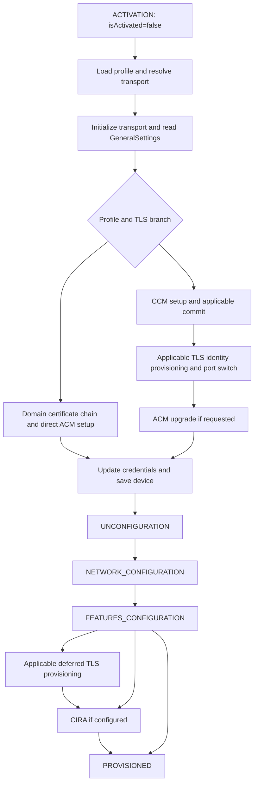

# Provisioning state-machine changes for issue #2935

This is the consolidated developer report for
[Optimize the RPS Provisioning State Machine](https://github.com/device-management-toolkit/rps/issues/2935)
on `analysis/provisioning-state-machine`, reviewed November 3, 2026. The baseline
is September release **v2.40.2**, commit
`583d61f0cd4ad080cac1baacdff5b1606d9079d3`. The branch at `7460bf9` includes
implementation through `b75d37f`; this consolidation changes documentation only.

Read the [implemented changes](#what-changed),
[hardware measurements](#hardware-measurements-and-their-limits),
[flow ordering](#provisioning-flows-and-unchanged-ordering),
[retained calls](#calls-and-recovery-behavior-retained),
[remaining ideas](#remaining-optimization-ideas),
[validation gaps](#verification-and-remaining-acceptance-work), or
[detailed inventory](#detailed-baseline-state-and-ws-man-inventory).

## What changed

We removed unused cleanup reads, reused a fresh TLS credential inventory, and
avoided replacing an existing TLS identity when live verification proves it
still satisfies the requested profile. Eligible reconfiguration also skips the
unchanged-certificate rollover wait. A later correction records TLS success
when the enrollment child is skipped.

First-time activation still creates its required identity and retains applicable
activation, upgrade, commit, and rollover behavior. The broadest measured gain
is for one TLS-enforced AMT 21 ACM reconfiguration profile; complete issue
acceptance and broader hardware validation remain outstanding.

### Candidate reference

The letters are identifiers for separate optimization ideas, not execution steps
or an implementation order. A, C, E, and F are implemented. B, D, G, and H remain
proposals; their predicted savings are not measured gains.

| ID | Descriptive name | Purpose and applicable flow | Status |
|---|---|---|---|
| A | Skip unused cleanup TLS reads | Avoid TLS-settings Enumerate/Pull during TLS-enforced activation or reconfiguration cleanup. | Implemented; tested on hardware in both flows |
| B | Choose non-TLS reconfiguration earlier | Route selected legacy/local non-TLS devices before a probe whose result that route ignores. | Proposed; legacy transport validation needed |
| C | Reuse a fresh TLS credential probe | Avoid a repeated credential-context Enumerate/Pull within the same valid attempt/session. | Implemented; combined reconfiguration tested |
| D | Update only changed features | Avoid unrelated feature writes when only part of KVM/SOL/IDER/listener configuration changes. | Proposed; firmware semantics need validation |
| E | Retain a verified existing TLS identity | Avoid key/certificate generation and TLS enrollment when live identity and requested policy match. | Implemented for eligible same-mode reconfiguration |
| F | Skip the unchanged-certificate wait | Avoid the five-second rollover wait for an approved unchanged identity while still creating a fresh tunnel. | Implemented for eligible reconfiguration |
| G | Skip unused initial enrollment reads | Avoid initial public-certificate Enumerate/Pull without losing their authentication/error recovery role. | Under investigation |
| H | Reuse a freshly verified CIRA trusted root | Avoid installing the exact CIRA root already proven trusted by complete fresh inventory. | Under investigation |

### Skip unused cleanup TLS reads (A)

In `unconfiguration.ts`, both MPS discovery/deletion paths previously converged
on TLS-settings Enumerate/Pull before a guard discarded the result for
`tlsEnforced === true`. An immediate transition now evaluates that guard before
the actors and goes to environment detection. The later guard remains defensive.
This removes **two nominal requests per eligible cleanup**, including the failure
opportunities of those unused reads. Non-TLS cleanup and MPS/environment failure
handling retain their existing routes.

### Reuse a fresh TLS credential probe (C)

`checkAmtTlsState` previously read TLS credential contexts immediately before
certificate validation read them again. The activation machine now carries a
complete probe snapshot tied to the tunnel session and valid for less than
30 seconds. Incomplete results, expiration, reset, reconnect, reconfiguration,
and new attempts prevent stale reuse. Public-certificate discovery, association
handles, and live/Vault fingerprint verification remain required. The nominal
saving is **two requests** when the snapshot qualifies; activation may also
benefit when it reaches that validation path.

### Retain a verified existing TLS identity (E)

Previously, validation could set `tlsNeedsProvisioning=false`, but the later
`needsPostProvisioningTLS` guard still entered enrollment because the runtime
newly-issued-certificate field was absent on a TLS-enforced request. The result
was key generation, certificate installation, TLS writes, and commit despite an
earlier live/Vault match.

The new approval distinguishes a retained identity from a newly issued one.
Reuse requires an already activated device in the same control mode, complete
fresh live discovery, a live/Vault leaf fingerprint match, and policy approval:

- Local and remote TLS enabled and requested remote settings matching.
- DMT-generated hostname matching and server-auth EKU present.
- Leaf signature verified against the freshly fetched requested MPS CA.
- CA and leaf currently valid with more than 30 days before expiration.
- No custom profile certificates, Microsoft CA, mutual TLS, Wi-Fi, or wired
  802.1X profile; these conservatively retain enrollment.

Fresh activation and CCM-to-ACM upgrades do not receive identity reuse approval.
After cleanup/network/features, `VERIFY_REUSABLE_TLS_IDENTITY` performs a final
live settings, credential-context, and certificate check: **six nominal reads**.
It requires the original approved fingerprint and current policy. Failed checks,
changed identity/settings, incomplete/stale data, and dependency errors fall
back to TLS provisioning. Successful verification goes to `ROUTE_REUSED_TLS`,
then CIRA if configured, otherwise completion.

On the measured eligible route this replaces a 17-request deferred TLS stage
with six verification requests. Together with A and C, the nominal arithmetic
is **64 − 2 − 2 − 17 + 6 = 49 requests**. This is route-specific; retries and
profile branches can change the count.

### Skip the unchanged-certificate wait (F)

Only policy-approved reuse in the validated session, with no reset or
reconfiguration pending, skips the existing five-second rollover wait. The old
tunnel still closes and a fresh tunnel is initialized with the managed trust
material. The one-use skip decision is cleared when the port-switch state exits.
Actual provisioning, commit, upgrade, and recovery waits remain.

The retained leaf uses `validatedCertPEM`, separate from `issuedCertPEM`.
`getTlsTrustMaterial` in `tlsReuse.ts` makes both activation and common transport
reconnect treat it as managed identity, disabling the temporary self-signed
fallback after approval. A newly issued certificate takes precedence.

### Report success when TLS enrollment is skipped

The measured combined build omitted the structured TLS result when it reused
an identity and skipped the TLS child. `b75d37f` fixes this by recording TLS
`Success` with `Already configured` in `ROUTE_REUSED_TLS`. This correction adds
no firmware operations and has automated routing/result coverage, but has not
yet been retested on hardware.

### Source and commit map

| Commit | Change |
|---|---|
| `c508f06` | Initial baseline analysis and state/call inventory |
| `1ded861` | Executable release characterizations |
| `9179ab1` | Cleanup read removal (A) |
| `9225d36` | Characterization of additional TLS reuse opportunities |
| `418f752` | Combined credential/identity/wait reuse (C/E/F) |
| `b75d37f` | Structured TLS success reporting on the reuse route |
| `7460bf9` | Remaining issue scope and optimization reassessment |

Production changes are in [activation.ts](../src/stateMachines/activation.ts),
[unconfiguration.ts](../src/stateMachines/unconfiguration.ts),
[common.ts](../src/stateMachines/common.ts),
[tlsReuse.ts](../src/stateMachines/tlsReuse.ts), and
[RCS.Config.ts](../src/models/RCS.Config.ts). Sibling machine
regressions, `src/test/provisioningAnalysis.test.ts`, and synthetic certificates
in `src/test/helper/TlsReuseCertificates.ts` provide automated evidence.

## Hardware measurements and their limits

| Scenario | September baseline | Cleanup-only build (`9179ab1`) | Combined build (`418f752`) |
|---|---|---|---|
| AMT 21 first-time activation duration | About 153.9 s | About 152.1 s | Not tested |
| First-time activation request blocks | 74 | 72 | Not tested |
| AMT 21 ACM reconfiguration duration | 95.534 s | 93.238 s | 68.770 s |
| Reconfiguration request blocks | 64 | 62 | 49 |

The combined reconfiguration observation is **26.764 seconds (28.02%)** shorter
than September. It confirms credential snapshot reuse, the skipped
unchanged-identity wait, final live revalidation, and absence of key generation,
certificate installation, and TLS commit on that route. Activation, wired
network, and CIRA reported success; MPS connectivity was not independently
confirmed. Digest 401 challenges and a tolerated cleanup HTTP 400/reset remain.

These are single-run observations from RPS activation receipt to final status,
not RPC command-start timings or established typical performance. Equivalent
initial device/profile state was not independently established. Do not sum
per-candidate time estimates or claim coverage for every profile/firmware path.
The first enrollment pair's roughly six-second interval includes tunnel/recovery
overhead and is not a measured saving for removing those reads.

Activation counts exclude three extra actor XML logs for `AddNextCertInChain`;
earlier counts of 77/75 double-counted them. Counts refer to transport request
log blocks, not packets or unique resource/selector operations.

Evidence recovered locally:

- `/tmp/rps-2935-request-count-audit.json`: corrected baseline/cleanup counts.
- `/tmp/rps-2935-reconfiguration-all-comparison.json`: combined timing, ordered
  request blocks, events, results, and stated limitations.
- `/tmp/rps-2935-reconfiguration-all.log`: private combined raw trace. The
  reassessment compared normalized certificate bytes at inventory line 497 and
  CIRA root-add line 520, with no intervening WS-Man mutation.

These temporary files are local supporting artifacts, not repository attachments
or durable published evidence. Keep raw logs private and prepare redacted
review evidence. At the November 3 local check, the running container was healthy
on `rps-2935-all:418f752a`; pulling source did not rebuild it or deploy the later
reporting fix.

## Provisioning flows and unchanged ordering

This section describes baseline branches and configuration dependencies. The
implemented reuse states and their additional checks are described above and
in the appendix's branch-difference table.

### First-time activation

`DataProcessor.activateDevice` validates the client request, sets connection parameters, and sends `ACTIVATION` or `ACTIVATED` according to `devices[clientId].activationStatus`. Reconfiguration therefore uses the activation machine with a different entry event; it is separate from the `MAINTENANCE` operations.

For first-time activation, `ACTIVATION` sets `isActivated=false`. The profile is loaded, then the optional legacy LMS routing evaluation runs. Its pre-provisioning and AMT 19+ checks preserve the appropriate transport rather than forcing a legacy non-TLS probe.

| Scenario | Port behavior and provisioning prerequisites |
|---|---|
| AMT 19+, TLS enforced | RPC starts on 16993. RPS initializes the TLS tunnel and validates factory trust before activation. CCM activation, commit/rollover, and certificate provisioning precede the applicable ACM upgrade. No initial 16992-to-16993 switch is required. |
| AMT 18 and below with `--tls-tunnel` | Starts on 16992, uses the CCM path, provisions TLS identity, signals RPC to switch to 16993, then continues over the tunnel and performs an ACM upgrade if the profile requires it. |
| AMT 18 and below without the tunnel flag | Starts on 16992. The applicable CCM or direct ACM path is selected by the profile. Subsequent TLS work depends on the release's profile/device guards; do not assume every legacy run switches ports. |
| ACM profile | Requires the configured domain provisioning certificate, trusted hash checks, certificate-chain injection, and signed nonce. Host-based setup/upgrade calls are one-shot; reconnect or timeout recovery checks activation state rather than blindly issuing setup again. |
| CCM profile | Does not require an ACM upgrade. The TLS and non-TLS branches still differ in commit, identity handling, and delays. |

The [TLS flow reference](https://github.com/device-management-toolkit/rpc-go/wiki/Activating-AMT-with-E2E-TLS-and-RPS) is orientation; version/profile guards and reachable transitions in this release remain the implementation evidence.

Typical successful first-time paths converge after activation, credential updates, and applicable TLS work:

This diagram groups conditional states. It does not imply every device visits CCM, TLS provisioning, upgrade, and CIRA.

### Reconfiguration

`ACTIVATED` sets `isActivated=true`. `CHECK_PROFILE_TYPE` first performs the tenant-access check. After transport initialization, `GET_GENERAL_SETTINGS`, and digest-realm validation, the machine enters `CHECK_AMT_TLS_STATE`.

| Existing device / requested operation | Release behavior |
|---|---|
| Non-TLS local routing selected | The release still invokes the TLS probe. The first `onDone` guard then selects `ROUTE_ACTIVATED_NON_TLS` irrespective of the probe result. This is the unimplemented earlier non-TLS routing idea (B). Keep the earlier LMS transport-selection probe where applicable. |
| TLS enabled with credential context | Validate the live TLS certificate against the Vault leaf certificate. Reuse matching identity; mark missing/mismatched identity for provisioning. Preserve certificate verification. |
| TLS absent or incomplete | Mark TLS provisioning when the selected route requires it. Proceed through the applicable credential/upgrade path and provision identity before later TLS traffic. |
| CCM to ACM | `canUpgrade` selects host-based setup/upgrade and the provisioning certificate path. It is not ordinary ACM-to-ACM reconfiguration. |
| ACM to ACM or CCM to CCM | Use the applicable password/credential path. Reuse valid TLS where possible, then converge on cleanup, network, features, and optional CIRA. |
| Failed certificate/TLS probe | Preserve the existing fallback and error branches. A cache must never convert a failed probe into successful validation or force an unintended non-TLS route. |

Repeated host-based setup reads used after a commit, upgrade, or timeout verify changed device state. They are not interchangeable with the initial read.

### Shared configuration stages and ordering

The actual successful ordering after cleanup is:

1. Network general settings check; `Put AMT_GeneralSettings` only when the network flags require it.
2. `Enumerate`/`Pull AMT_EthernetPortSettings` to discover wired and wireless interfaces.
3. Wired configuration if supported. The release skips the wired Ethernet `Put` when TLS is enforced, then evaluates wired 802.1X. Otherwise it writes the applicable Ethernet settings. Wired 802.1X may obtain credentials/certificates from Enterprise Assistant, generate/sign a key, install certificates, update settings, and bind certificates according to the authentication protocol.
4. Wireless configuration if selected by interface/profile guards. This includes the retransmission setting, Wi-Fi service/synchronization settings, endpoint state, and profile loop. Enterprise wireless profiles have their own 802.1X/certificate path; local/UEFI synchronization and profile installation are distinct branches.
5. **CIRA proxy configuration** (`PROXY_CONFIGURATION`) inside the network machine when the profile supplies proxies. Each proxy is added with `IPS.HTTPProxyService.AddProxyAccessPoint`.
6. AMT features: redirection, KVM, and opt-in. Current values are read, then updates are conditional.
7. Applicable deferred TLS provisioning, followed by CIRA when configured.
8. CIRA: load configuration/password, add its trusted root, save secrets/register with MPS, add the MPS server, discover its reference, add periodic and user-initiated policies, update policy-to-MPS associations, enable the connection service, and update environment detection.

**Proxy configuration precedes the CIRA connection stage in this release.** The issue's orientation list must not be used to reorder these stages without dependency evidence. The wireless-only and unsupported-interface branches also need independent coverage; not every network path visits every child machine.

## Calls and recovery behavior retained

These reasons apply outside the explicitly approved reuse routes above. Keeping
a verified existing identity does not justify removing required enrollment or
recovery operations on other paths.

| Calls | Why unconditional removal is not justified |
|---|---|
| Ethernet inventory in cleanup and network configuration | Cleanup can change 802.1X/Wi-Fi state, and network general settings may then be written. A later inventory must not silently receive a stale snapshot. Any reuse needs a defined field-level freshness contract. |
| Three remote-access-policy deletes during cleanup | They target distinct user-initiated, alert, and periodic selectors. Pre-provisioning mode does not prove an absence of remnants after partial provisioning. Enumerating then deleting only present rules may save one request for an empty store, but adds discovery requests for populated stores and needs firmware/selector evidence. |
| Public-certificate/root installation in TLS and CIRA | The configured CIRA root and the root used to issue the TLS identity need not match. Cleanup or certificate rotation can invalidate earlier knowledge. Match actual certificate fingerprints and prove persistence before skipping an install. |
| Two CIRA policy-association `Put` requests | They apply to separate policy associations. Count selectors rather than collapsing identical action/resource labels. |
| Environment-detection reads/updates in cleanup and CIRA | Cleanup and final configuration have different purposes and are separated by operations that may fail. Removing early cleanup changes partial-provisioning behavior. |
| Generate-key, enumerate/pull-key, sign, and add-certificate sequences | Generation responses supply a handle; later reads supply key material/references used by enrollment. A repeated resource name does not prove duplicated work. |
| Digest 401 retry, transport retry, post-commit verification | Authentication challenges, recoverable transport failures, and activation-state changes require these branches. Count them separately from nominal calls. |
| Intentional synchronization/rollover delays | Reducing a timer is not a validated removal of a WS-Man call. Preserve existing waits unless separate timing evidence proves a change safe. |

Do not treat an HTTP 400 as proof that a delete can be removed. This release tolerates particular cleanup errors and resets the tunnel on non-401 failures; `Connection: close` and actual transport failures still require reconnect handling.

## Remaining optimization ideas

### Choose non-TLS reconfiguration earlier (B)

The baseline TLS probe reads settings and, if enabled, credential contexts before
an already-selected non-TLS route ignores its result. Segmented scenarios show
**two or four potentially avoidable reads**, including non-TLS same-mode and
CCM-to-ACM routing. Retain the earlier LMS transport-selection probe and explicit
tunnel/TLS-enforced validation. Legacy hardware, digest/failure behavior, and
required later provisioning must be validated before changing routing.

### Update only changed features (D)

The combined redirection-change flag includes SOL, IDER, listener, and KVM.
A subset change can therefore trigger the full redirection/KVM setter sequence.
An independent KVM-change guard might avoid **one request** when KVM is already
correct. Verify firmware `RequestStateChange` semantics, enabled-but-offline
states, listener coupling, opt-in, independent enable/disable scenarios, and
failure propagation. The unchanged measured reconfiguration emitted no feature
setters, so this idea offers no demonstrated saving on that profile.

### Reuse a freshly verified CIRA trusted root (H)

The source supports a narrow optimization but does not currently expose the
evidence required to implement it safely:

1. `getActiveTlsCertificateFingerprints` reads public certificates and captures
   `tlsValidationSnapshot` only when the probe is current and the certificate
   pull is complete.
2. `validateActivatedTlsIdentity` creates a separate validation input. Its
   result returns reuse approval, fingerprint, and session information, but
   does not return the complete certificate inventory.
3. `verifyReusableTlsIdentity` performs the final probe and validation, then
   returns only a boolean. The parent cannot pass the final inventory to CIRA.
4. The parent invokes CIRA with profile, transport, message, and tenant data.
   CIRA reloads its configuration in `GET_CIRA_CONFIG`, reads its password,
   and unconditionally reaches `ADD_TRUSTED_ROOT_CERTIFICATE`.

An earlier snapshot or a cached root used for tunnel trust is insufficient:
cleanup and transport changes precede final verification. The certificate to
compare must also be the root from CIRA's newly loaded configuration, rather
than an assumption that the TLS CA and CIRA CA are identical.

Proposed handoff: return an optional complete trusted-root inventory with the
successful final verification result, including attempt identity, tunnel session,
and capture time. Pass it explicitly into the CIRA child. After loading the
actual CIRA configuration and immediately before the root-add decision, require
the same attempt/session, a bounded age, no reset or reconfiguration pending,
and no intervening certificate-store mutation. Compare normalized DER bytes
or their SHA-256 fingerprints and require the firmware's trusted-root flag
(`TrustedRootCertficate`) to indicate a trusted root.

Missing, malformed, incomplete, expired, changed-session, or mismatched evidence
must retain the existing root-add state. A skipped root addition must continue
to `SAVE_MPS_PASSWORD_TO_SECRET_PROVIDER`, preserving password persistence,
MPS registration, policy setup, and result reporting. It must not fabricate a
WS-Man response or treat the entire CIRA configuration as already complete.

The nominal benefit is one request on an eligible reconfiguration: 49 to 48
for the previously measured profile if all conditions still hold. This is a
prediction, not a measured duration improvement. Additional inventory reads
solely to avoid one write would erase the request-count benefit.

Required regressions: matching PEM/DER encodings, different/rotated root,
untrusted matching certificate, incomplete/malformed inventory, absent evidence,
new attempt, changed session, reset, expiration during configuration/password
lookup, retry after an invalidating operation, and both ordinary and skipped
root-add routes reaching the existing persistence and policy states. First-time
activation should retain root installation until certificate-store persistence
through enrollment, upgrade, and cleanup is independently proven.

### Skip unused initial enrollment reads (G)

`CONFIGURE_TLS` currently routes through public-certificate Enumerate/Pull before
`CHECK_CERT_MODE`. The signing-authority guard chooses Enterprise Assistant or
root installation; it does not use that inventory. Nevertheless, the states
have observable failure behavior:

- Enumerate HTTP 401 routes through `ERROR`, whose completion retries Enumerate.
- Pull retries `UNEXPECTED_PARSE_ERROR` through Enumerate, within the existing
  retry bound, and resets the retry count on success.
- Root installation currently sends every rejected invocation to `FAILED`.

Therefore changing the entry target to `CHECK_CERT_MODE` alone does not preserve
the authentication recovery contract. A separately scoped optimization must
prove how authentication challenges are recovered at the first retained
operation, with bounded retries and the proper retry target. Read retry
behavior must not be generalized blindly to certificate-store writes: an
ambiguous transport failure after a write can require state discovery before
replay. Enterprise Assistant remains a separate branch to characterize.

Required evidence includes an authenticated success route, stale-nonce 401,
malformed responses, exhausted recovery, reset/reconnect, partial enrollment,
Enterprise Assistant, and actual TLS rollover. Preserve live identity/trust
reads and post-commit waits and verification. Two nominal enrollment reads are
the candidate saving; the earlier six-second interval includes recovery and
tunnel overhead and cannot be claimed as removable time.

## Verification and remaining acceptance work

Local checks against the pulled branch passed on November 3: **1,118 tests in
98 files**, `npm run lint`, `npm run ci-prettify`, and `git diff --check`. The
current session used Node 26 and installed the branch lockfile dependencies;
the default host Node 12 was unsuitable. Earlier implementation checks also
recorded TypeScript `--noEmit` and compilation passing. The unoptimized release
baseline had 1,062 tests in 97 files. Automated results are separate from
hardware performance and profile coverage.

The segmented characterization tests use real XState transitions, actor logic,
guards, and SDK builders with scripted external responses. They reconstruct
baseline cleanup by removing only A's immediate transition and terminate outside
the characterized segments. They demonstrate discarded reads and routing, not
full provisioning, digest transport, or hardware correctness. Sibling regressions
cover A's retained MPS/environment failures and C/E/F's cache invalidation,
incomplete reads, real synthetic certificate validation, policy/expiry/hostname
mismatches, upgrade/fresh-activation exclusion, final fallback, tunnel trust,
wait retention, CIRA routing, and TLS results.

| Acceptance area | Evidence now | Remaining validation |
|---|---|---|
| Activation and reconfiguration state/call mapping | Flow description, baseline appendix, and implemented-state changes below | Validate additional profile/device paths; baseline appendix is not an optimized runtime trace |
| First-time activation improvement | A tested in both flows | Combined first-time activation from equivalent initial state, including reporting correction |
| Comparable duration and request counts | Single-run baseline/cleanup/combined observations | Repeat matched runs; obtain RPC command-start timing if available |
| Complete applicable configuration stages | Tested activation, wired network, and CIRA results; live TLS checks | Wired 802.1X, Wi-Fi, proxy, unsupported/alternate interfaces, no-CIRA profiles; confirm connectivity through MPS |
| Alternate TLS/control-mode paths | Automated eligibility and fallback tests | Legacy tunnel/non-TLS, upgrades, missing/mismatched/rotated identities and changed TLS settings |
| Failures, reconnects, partial provisioning | Regressions and successful traces containing digest challenges and cleanup reset | Hardware faults, interrupted/partial enrollment, dependency failures, and reporting-fix retest |
| Review and release evidence | This consolidated report and private/redacted local artifacts | Durable concise review attachments and release note when ready; issue acceptance remains incomplete |

For matched comparisons, record device/firmware, initial provisioning/control
mode, full profile contents, RPC build/flags, server/dependency versions, network,
and timers. First-time runs require equivalent fresh states; a later invocation
on the activated device measures reconfiguration. Capture an isolated
`RPS_LOG_LEVEL=silly` trace per run, privately, with state/actor, action/resource,
selector/payload identity, timestamps/statuses, retries, reconnects, and waits.
Compare nominal and actual calls, total/per-stage duration, tunnel time/count,
and all applicable component results. Inspect MPS connectivity independently.

Recommended next work: validate the current combined implementation and reporting
fix in first-time activation and repeated reconfiguration, then investigate H
narrowly and G's recovery dependencies separately. Explore B/D with qualifying
legacy devices or selective-change profiles. No further production optimization,
hardware activation/reset, container update, or publication was performed by
this documentation consolidation.

## Detailed baseline state and WS-Man inventory

This appendix preserves the September release inventory as supporting evidence.
It is static, not a runtime sequence or proof of reachability. Actor builder
names do not include every selector/payload distinction; local/child/service
operations are not WS-Man request counts. Enumerate and Pull are distinct
requests, and loops, digest challenges, and retries require separate accounting.

The implemented branch differs from the baseline in these key states:

| State/actor | Current behavior relative to baseline |
|---|---|
| Cleanup `ENUMERATE_TLS_SETTING_DATA` | Immediate TLS-enforcement guard goes to environment detection before invoking Enumerate/Pull |
| Activation `VALIDATE_ACTIVATED_DEVICE_TLS_CERT` | Uses `validateActivatedTlsIdentity`, which performs live validation and conservative reuse policy approval |
| Activation credential-context validation | Consumes a complete current probe snapshot when eligible; otherwise reads again |
| `SIGNAL_ACTIVATED_PORT_SWITCH` | May skip only the approved unchanged-identity wait; fresh tunnel still required |
| `FEATURES_CONFIGURATION` | Eligible already-activated reuse approval first routes to `VERIFY_REUSABLE_TLS_IDENTITY` |
| `VERIFY_REUSABLE_TLS_IDENTITY` | Six nominal live verification reads; success routes to `ROUTE_REUSED_TLS`, false/error falls back to root fetch and TLS enrollment |
| `ROUTE_REUSED_TLS` | Records TLS success and routes to CIRA or completion |

September v2.40.2 state, actor, message builder, and transition tables

### activation

| State | Actor / WS-Man builders | Direct targets |
|---|---|---|
| `UNPROVISIONED` | — | `GET_AMT_PROFILE` |
| `GET_AMT_PROFILE` | `getAMTProfile` (child/control/local/service operation; inspect actor) | `EVALUATE_LEGACY_LMS_NON_TLS_OVERRIDE`, `FAILED` |
| `EVALUATE_LEGACY_LMS_NON_TLS_OVERRIDE` | `evaluateLegacyLmsNonTlsOverride`: `amt.TLSSettingData.Enumerate`, `amt.TLSSettingData.Pull` | `CHECK_PROFILE_TYPE` |
| `CHECK_PROFILE_TYPE` | — | `CHECK_TENANT_ACCESS`, `INIT_TLS_TUNNEL`, `GET_AMT_DOMAIN_CERT` |
| `CHECK_TENANT_ACCESS` | `getDeviceFromMPS` (child/control/local/service operation; inspect actor) | `DETERMINE_CAN_ACTIVATE`, `INIT_TLS_TUNNEL` |
| `DETERMINE_CAN_ACTIVATE` | — | `INIT_TLS_TUNNEL`, `GET_AMT_DOMAIN_CERT`, `FAILED` |
| `GET_AMT_DOMAIN_CERT` | `getAMTDomainCert` (child/control/local/service operation; inspect actor) | `EXTRACT_DOMAIN_CERT`, `FAILED` |
| `EXTRACT_DOMAIN_CERT` | — | `COMPARE_DEVICE_HASHES`, `FAILED` |
| `COMPARE_DEVICE_HASHES` | — | `INIT_TLS_TUNNEL`, `FAILED` |
| `INIT_TLS_TUNNEL` | `initializeTLSTunnel` (child/control/local/service operation; inspect actor) | `GET_GENERAL_SETTINGS`, `FAILED` |
| `GET_GENERAL_SETTINGS` | `getGeneralSettings`: `amt.GeneralSettings.Get` | `READ_GENERAL_SETTINGS`, `ERROR` |
| `READ_GENERAL_SETTINGS` | — | `CHECK_DIGEST_REALM` |
| `CHECK_DIGEST_REALM` | — | `INVALID_DIGEST_REALM`, `CHECK_AMT_TLS_STATE`, `IPS_HOST_BASED_SETUP_SERVICE`, `CHANGE_AMT_PASSWORD`, `SETUP` |
| `IPS_HOST_BASED_SETUP_SERVICE` | `getHostBasedSetupService`: `ips.HostBasedSetupService.Get` | `CHANGE_AMT_PASSWORD`, `ADD_NEXT_CERT_IN_CHAIN`, `ERROR` |
| `ADD_NEXT_CERT_IN_CHAIN` | `getNextCERTInChain`: `ips.HostBasedSetupService.AddNextCertInChain` | `CHECK_CERT_CHAIN_RESPONSE`, `ERROR` |
| `CHECK_CERT_CHAIN_RESPONSE` | — | `FAILED`, `ADD_NEXT_CERT_IN_CHAIN`, `UPGRADE_TO_ADMIN_SETUP`, `ADMIN_SETUP` |
| `ADMIN_SETUP` | `sendAdminSetup`: `ips.HostBasedSetupService.AdminSetup` | `CHECK_ADMIN_SETUP`, `CHECK_ACTIVATION_ON_AMT`, `DEACTIVATION`, `ERROR` |
| `CHECK_ADMIN_SETUP` | — | `COMMIT_CHANGES`, `DELAYED_TRANSITION`, `DEACTIVATION`, `FAILED` |
| `UPGRADE_TO_ADMIN_SETUP` | `sendUpgradeClientToAdmin`: `ips.HostBasedSetupService.UpgradeClientToAdmin` | `CHECK_UPGRADE`, `CHECK_ACTIVATION_ON_AMT`, `DEACTIVATION`, `ERROR` |
| `CHECK_UPGRADE` | — | `COMMIT_CHANGES`, `CHANGE_AMT_PASSWORD`, `DEACTIVATION`, `FAILED` |
| `SETUP` | `sendClientSetup`: `ips.HostBasedSetupService.Setup` | `COMMIT_CHANGES`, `CHECK_SETUP`, `CHECK_ACTIVATION_ON_AMT`, `ERROR` |
| `COMMIT_CHANGES` | `commitChanges`: `amt.SetupAndConfigurationService.CommitChanges` | `SET_MEBX_PASSWORD`, `CHECK_SETUP`, `WAIT_AFTER_COMMIT`, `CHECK_ACTIVATION_ON_AMT`, `ERROR` |
| `WAIT_AFTER_COMMIT` | — | `CHECK_SETUP` |
| `CHECK_SETUP` | — | `DELAYED_TRANSITION`, `FAILED` |
| `CHECK_ACTIVATION_ON_AMT` | `getActivationStatus`: `ips.HostBasedSetupService.Get` | `CHECK_UPGRADE`, `CHECK_ADMIN_SETUP`, `CHECK_SETUP`, `ERROR` |
| `DELAYED_TRANSITION` | — | `UPDATE_CREDENTIALS` |
| `UPDATE_CREDENTIALS` | — | `FETCH_POST_PROVISIONING_ROOT_KEY`, `SAVE_DEVICE_TO_SECRET_PROVIDER`, `SET_MEBX_PASSWORD` |
| `SET_MEBX_PASSWORD` | `setMEBxPassword`: `amt.SetupAndConfigurationService.SetMEBXPassword` | `SAVE_DEVICE_TO_SECRET_PROVIDER`, `DEACTIVATION`, `ERROR` |
| `SAVE_DEVICE_TO_SECRET_PROVIDER` | `saveDeviceInfoToSecretProvider` (child/control/local/service operation; inspect actor) | `SAVE_DEVICE_TO_MPS`, `SAVE_DEVICE_TO_SECRET_PROVIDER_FAILURE` |
| `SAVE_DEVICE_TO_MPS` | `saveDeviceInfoToMPS` (child/control/local/service operation; inspect actor) | `FETCH_MPS_ROOT_KEY`, `UNCONFIGURATION`, `SAVE_DEVICE_TO_MPS_FAILURE` |
| `SAVE_DEVICE_TO_SECRET_PROVIDER_FAILURE` | — | `FAILED` |
| `SAVE_DEVICE_TO_MPS_FAILURE` | — | `FAILED` |
| `CHECK_AMT_TLS_STATE` | `checkAmtTlsState`: `amt.TLSSettingData.Enumerate`, `amt.TLSSettingData.Pull`, `amt.TLSCredentialContext.Enumerate`, `amt.TLSCredentialContext.Pull` | `ROUTE_ACTIVATED_NON_TLS`, `VALIDATE_ACTIVATED_DEVICE_TLS_CERT`, `IPS_HOST_BASED_SETUP_SERVICE`, `CHANGE_AMT_PASSWORD` |
| `VALIDATE_ACTIVATED_DEVICE_TLS_CERT` | `validateDeviceTlsCert`: `amt.TLSCredentialContext.Enumerate`, `amt.TLSCredentialContext.Pull`, `amt.PublicKeyCertificate.Enumerate`, `amt.PublicKeyCertificate.Pull` | `ROUTE_ACTIVATED_NON_TLS`, `SIGNAL_ACTIVATED_PORT_SWITCH` |
| `ROUTE_ACTIVATED_NON_TLS` | — | `IPS_HOST_BASED_SETUP_SERVICE`, `CHANGE_AMT_PASSWORD` |
| `SIGNAL_ACTIVATED_PORT_SWITCH` | `signalPortSwitch` (child/control/local/service operation; inspect actor) | `INIT_ACTIVATED_TLS_TUNNEL`, `IPS_HOST_BASED_SETUP_SERVICE`, `CHANGE_AMT_PASSWORD` |
| `INIT_ACTIVATED_TLS_TUNNEL` | `initializeTlsTunnelConnection` (child/control/local/service operation; inspect actor) | `IPS_HOST_BASED_SETUP_SERVICE`, `CHANGE_AMT_PASSWORD` |
| `FETCH_MPS_ROOT_KEY` | `fetchMPSRootKey` (child/control/local/service operation; inspect actor) | `VALIDATE_DEVICE_TLS_CERT`, `FAILED` |
| `VALIDATE_DEVICE_TLS_CERT` | `validateDeviceTlsCert`: `amt.TLSCredentialContext.Enumerate`, `amt.TLSCredentialContext.Pull`, `amt.PublicKeyCertificate.Enumerate`, `amt.PublicKeyCertificate.Pull` | `SIGNAL_PORT_SWITCH`, `TLS_TUNNEL_PROVISIONING` |
| `TLS_TUNNEL_PROVISIONING` | `tlsTunnelProvisioning` (child/control/local/service operation; inspect actor) | `CHECK_TLS_TUNNEL_RESULT`, `FAILED` |
| `CHECK_TLS_TUNNEL_RESULT` | — | `SAVE_TLS_TUNNEL_CERTS`, `FAILED` |
| `SAVE_TLS_TUNNEL_CERTS` | `saveTlsTunnelCerts` (child/control/local/service operation; inspect actor) | `SIGNAL_PORT_SWITCH`, `FAILED` |
| `SIGNAL_PORT_SWITCH` | `signalPortSwitch` (child/control/local/service operation; inspect actor) | `INIT_TLS_TUNNEL_CONNECTION`, `FAILED` |
| `INIT_TLS_TUNNEL_CONNECTION` | `initializeTlsTunnelConnection` (child/control/local/service operation; inspect actor) | `GET_AMT_DOMAIN_CERT`, `UNCONFIGURATION`, `FAILED` |
| `CHANGE_AMT_PASSWORD` | `changeAMTPassword`: `amt.AuthorizationService.SetAdminACLEntryEx` | `UPDATE_CREDENTIALS`, `DEACTIVATION`, `ERROR` |
| `UNCONFIGURATION` | `unconfiguration` (child/control/local/service operation; inspect actor) | `NETWORK_CONFIGURATION` |
| `NETWORK_CONFIGURATION` | `networkConfiguration` (child/control/local/service operation; inspect actor) | `FEATURES_CONFIGURATION` |
| `FEATURES_CONFIGURATION` | `featuresConfiguration` (child/control/local/service operation; inspect actor) | `FETCH_POST_PROVISIONING_ROOT_KEY`, `CIRA`, `PROVISIONED` |
| `CIRA` | `cira` (child/control/local/service operation; inspect actor) | `PROVISIONED` |
| `FETCH_POST_PROVISIONING_ROOT_KEY` | `fetchMPSRootKey` (child/control/local/service operation; inspect actor) | `TLS`, `FAILED` |
| `TLS` | `tls` (child/control/local/service operation; inspect actor) | `SAVE_POST_PROVISIONING_CERTS`, `PROVISIONED` |
| `SAVE_POST_PROVISIONING_CERTS` | `saveTlsTunnelCerts` (child/control/local/service operation; inspect actor) | `SIGNAL_PORT_SWITCH`, `CIRA`, `PROVISIONED` |
| `DEACTIVATION` | `invokeUnprovision`: `amt.SetupAndConfigurationService.Unprovision` | `FINAL` |
| `PROVISIONED` | — | — |
| `ERROR` | `error` (child/control/local/service operation; inspect actor) | `NEXT_STATE`, `DEACTIVATION`, `FAILED` |
| `NEXT_STATE` | — | `DEACTIVATION`, `GET_GENERAL_SETTINGS`, `SET_MEBX_PASSWORD`, `CHECK_ACTIVATION_ON_AMT`, `FAILED` |
| `INVALID_DIGEST_REALM` | — | `FAILED` |
| `FAILED` | — | `DEACTIVATION`, `FINAL` |
| `FINAL` | — | — |

### unconfiguration

| State | Actor / WS-Man builders | Direct targets |
|---|---|---|
| `UNCONFIGURED` | — | `ENUMERATE_ETHERNET_PORT_SETTINGS` |
| `ERROR` | `errorMachine` (child/control/local/service operation; inspect actor) | `ENUMERATE_ETHERNET_PORT_SETTINGS`, `FAILURE` |
| `ENUMERATE_ETHERNET_PORT_SETTINGS` | `enumerateEthernetPortSettings`: `amt.EthernetPortSettings.Enumerate` | `PULL_ETHERNET_PORT_SETTINGS`, `ERROR` |
| `PULL_ETHERNET_PORT_SETTINGS` | `pullEthernetPortSettings`: `amt.EthernetPortSettings.Pull` | `CHECK_ETHERNET_PORT_SETTINGS_PULL_RESPONSE`, `ENUMERATE_ETHERNET_PORT_SETTINGS`, `FAILURE` |
| `CHECK_ETHERNET_PORT_SETTINGS_PULL_RESPONSE` | — | `GET_8021X_PROFILE`, `ENUMERATE_WIFI_ENDPOINT_SETTINGS` |
| `GET_8021X_PROFILE` | `get8021xProfile`: `ips.IEEE8021xSettings.Get` | `CHECK_GET_8021X_PROFILE_RESPONSE`, `FAILURE` |
| `CHECK_GET_8021X_PROFILE_RESPONSE` | — | `DISABLE_IEEE8021X_WIRED`, `ENUMERATE_WIFI_ENDPOINT_SETTINGS`, `ENUMERATE_HTTP_PROXY_ACCESS_POINT` |
| `DISABLE_IEEE8021X_WIRED` | `disableWired8021xConfiguration`: `ips.IEEE8021xSettings.Put` | `ENUMERATE_WIFI_ENDPOINT_SETTINGS`, `ENUMERATE_HTTP_PROXY_ACCESS_POINT`, `FAILURE` |
| `ENUMERATE_WIFI_ENDPOINT_SETTINGS` | `enumerateWifiEndpointSettings`: `cim.WiFiEndpointSettings.Enumerate` | `PULL_WIFI_ENDPOINT_SETTINGS`, `FAILURE` |
| `PULL_WIFI_ENDPOINT_SETTINGS` | `pullWifiEndpointSettings`: `cim.WiFiEndpointSettings.Pull` | `CHECK_WIFI_ENDPOINT_SETTINGS_PULL_RESPONSE`, `ENUMERATE_WIFI_ENDPOINT_SETTINGS`, `FAILURE` |
| `CHECK_WIFI_ENDPOINT_SETTINGS_PULL_RESPONSE` | — | `DELETE_WIFI_ENDPOINT_SETTINGS`, `ENUMERATE_HTTP_PROXY_ACCESS_POINT` |
| `DELETE_WIFI_ENDPOINT_SETTINGS` | `deleteWiFiProfileOnAMTDevice`: `cim.WiFiEndpointSettings.Delete` | `CHECK_WIFI_ENDPOINT_SETTINGS_DELETE_RESPONSE`, `FAILURE` |
| `CHECK_WIFI_ENDPOINT_SETTINGS_DELETE_RESPONSE` | — | `FAILURE`, `DELETE_WIFI_ENDPOINT_SETTINGS`, `ENUMERATE_HTTP_PROXY_ACCESS_POINT` |
| `ENUMERATE_HTTP_PROXY_ACCESS_POINT` | `enumerateHTTPProxyAccessPoint`: `ips.HTTPProxyAccessPoint.Enumerate` | `PULL_HTTP_PROXY_ACCESS_POINT`, `FAILURE` |
| `PULL_HTTP_PROXY_ACCESS_POINT` | `pullHTTPProxyAccessPoint`: `ips.HTTPProxyAccessPoint.Pull` | `CHECK_HTTP_PROXY_ACCESS_POINT_PULL_RESPONSE`, `ENUMERATE_HTTP_PROXY_ACCESS_POINT`, `FAILURE` |
| `CHECK_HTTP_PROXY_ACCESS_POINT_PULL_RESPONSE` | — | `PULL_HTTP_PROXY_ACCESS_POINT`, `DELETE_HTTP_PROXY_ACCESS_POINT`, `REMOVE_REMOTE_ACCESS_POLICY_RULE_USER_INITIATED` |
| `DELETE_HTTP_PROXY_ACCESS_POINT` | `deleteHTTPProxyAccessPoint`: `ips.HTTPProxyAccessPoint.Delete` | `CHECK_HTTP_PROXY_ACCESS_POINT_DELETE_RESPONSE`, `FAILURE` |
| `CHECK_HTTP_PROXY_ACCESS_POINT_DELETE_RESPONSE` | — | `DELETE_HTTP_PROXY_ACCESS_POINT`, `REMOVE_REMOTE_ACCESS_POLICY_RULE_USER_INITIATED` |
| `REMOVE_REMOTE_ACCESS_POLICY_RULE_USER_INITIATED` | `removeRemoteAccessPolicyRuleUserInitiated`: `amt.RemoteAccessPolicyRule.Delete` | `REMOVE_REMOTE_ACCESS_POLICY_RULE_ALERT`, `ERROR` |
| `REMOVE_REMOTE_ACCESS_POLICY_RULE_ALERT` | `removeRemoteAccessPolicyRuleAlert`: `amt.RemoteAccessPolicyRule.Delete` | `REMOVE_REMOTE_ACCESS_POLICY_RULE_PERIODIC` |
| `REMOVE_REMOTE_ACCESS_POLICY_RULE_PERIODIC` | `removeRemoteAccessPolicyRulePeriodic`: `amt.RemoteAccessPolicyRule.Delete` | `ENUMERATE_MANAGEMENT_PRESENCE_REMOTE_SAP` |
| `ENUMERATE_MANAGEMENT_PRESENCE_REMOTE_SAP` | `enumerateManagementPresenceRemoteSAP`: `amt.ManagementPresenceRemoteSAP.Enumerate` | `PULL_MANAGEMENT_PRESENCE_REMOTE_SAP`, `FAILURE` |
| `PULL_MANAGEMENT_PRESENCE_REMOTE_SAP` | `pullManagementPresenceRemoteSAP`: `amt.ManagementPresenceRemoteSAP.Pull` | `PULL_MANAGEMENT_PRESENCE_REMOTE_SAP_RESPONSE`, `FAILURE` |
| `PULL_MANAGEMENT_PRESENCE_REMOTE_SAP_RESPONSE` | — | `DELETE_MANAGEMENT_PRESENCE_REMOTE_SAP`, `ENUMERATE_TLS_SETTING_DATA` |
| `DELETE_MANAGEMENT_PRESENCE_REMOTE_SAP` | `deleteRemoteAccessService`: `amt.ManagementPresenceRemoteSAP.Delete` | `ENUMERATE_TLS_SETTING_DATA`, `FAILURE` |
| `ENUMERATE_TLS_SETTING_DATA` | `enumerateTLSSettingData`: `amt.TLSSettingData.Enumerate` | `PULL_TLS_SETTING_DATA`, `FAILURE` |
| `PULL_TLS_SETTING_DATA` | `pullTLSSettingData`: `amt.TLSSettingData.Pull` | `PULL_TLS_SETTING_DATA_RESPONSE`, `FAILURE` |
| `PULL_TLS_SETTING_DATA_RESPONSE` | — | `GET_ENVIRONMENT_DETECTION_SETTINGS`, `DISABLE_TLS_SETTING_DATA`, `ENUMERATE_PUBLIC_PRIVATE_KEY_PAIR`, `ENUMERATE_PUBLIC_KEY_CERTIFICATE` |
| `DISABLE_TLS_SETTING_DATA` | `disableRemoteTLSSettingData`: `amt.TLSSettingData.Put` | `DISABLE_TLS_SETTING_DATA_RESPONSE`, `SETUP_AND_CONFIGURATION_SERVICE_COMMIT_CHANGES` |
| `DISABLE_TLS_SETTING_DATA_2` | `disableLocalTLSSettingData`: `amt.TLSSettingData.Put` | `DISABLE_TLS_SETTING_DATA_RESPONSE`, `SETUP_AND_CONFIGURATION_SERVICE_COMMIT_CHANGES` |
| `DISABLE_TLS_SETTING_DATA_RESPONSE` | — | `DISABLE_TLS_SETTING_DATA_2`, `SETUP_AND_CONFIGURATION_SERVICE_COMMIT_CHANGES`, `FAILURE` |
| `SETUP_AND_CONFIGURATION_SERVICE_COMMIT_CHANGES` | `commitSetupAndConfigurationService`: `amt.SetupAndConfigurationService.CommitChanges` | `SETUP_AND_CONFIGURATION_SERVICE_COMMIT_CHANGES_RESPONSE`, `FAILURE` |
| `SETUP_AND_CONFIGURATION_SERVICE_COMMIT_CHANGES_RESPONSE` | — | `ENUMERATE_TLS_CREDENTIAL_CONTEXT` |
| `ENUMERATE_TLS_CREDENTIAL_CONTEXT` | `enumerateTLSCredentialContext`: `amt.TLSCredentialContext.Enumerate` | `PULL_TLS_CREDENTIAL_CONTEXT`, `FAILURE` |
| `PULL_TLS_CREDENTIAL_CONTEXT` | `pullTLSCredentialContext`: `amt.TLSCredentialContext.Pull` | `PULL_TLS_CREDENTIAL_CONTEXT_RESPONSE`, `FAILURE` |
| `PULL_TLS_CREDENTIAL_CONTEXT_RESPONSE` | — | `DELETE_TLS_CREDENTIAL_CONTEXT`, `ENUMERATE_PUBLIC_PRIVATE_KEY_PAIR` |
| `DELETE_TLS_CREDENTIAL_CONTEXT` | `deleteTLSCredentialContext`: `amt.TLSCredentialContext.Delete` | `ENUMERATE_PUBLIC_PRIVATE_KEY_PAIR` |
| `ENUMERATE_PUBLIC_PRIVATE_KEY_PAIR` | `enumeratePublicPrivateKeyPair`: `amt.PublicPrivateKeyPair.Enumerate` | `PULL_PUBLIC_PRIVATE_KEY_PAIR`, `FAILURE` |
| `PULL_PUBLIC_PRIVATE_KEY_PAIR` | `pullPublicPrivateKeyPair`: `amt.PublicPrivateKeyPair.Pull` | `PULL_PUBLIC_PRIVATE_KEY_PAIR_RESPONSE`, `FAILURE` |
| `PULL_PUBLIC_PRIVATE_KEY_PAIR_RESPONSE` | — | `DELETE_PUBLIC_PRIVATE_KEY_PAIR`, `ENUMERATE_PUBLIC_KEY_CERTIFICATE` |
| `DELETE_PUBLIC_PRIVATE_KEY_PAIR` | `deletePublicPrivateKeyPair`: `amt.PublicPrivateKeyPair.Delete` | `PULL_PUBLIC_PRIVATE_KEY_PAIR_RESPONSE` |
| `ENUMERATE_PUBLIC_KEY_CERTIFICATE` | `enumeratePublicKeyCertificate`: `amt.PublicKeyCertificate.Enumerate` | `PULL_PUBLIC_KEY_CERTIFICATE`, `FAILURE` |
| `PULL_PUBLIC_KEY_CERTIFICATE` | `pullPublicKeyCertificate`: `amt.PublicKeyCertificate.Pull` | `PULL_PUBLIC_KEY_CERTIFICATE_RESPONSE`, `FAILURE` |
| `PULL_PUBLIC_KEY_CERTIFICATE_RESPONSE` | — | `DELETE_PUBLIC_KEY_CERTIFICATE`, `GET_ENVIRONMENT_DETECTION_SETTINGS` |
| `DELETE_PUBLIC_KEY_CERTIFICATE` | `deletePublicKeyCertificate`: `amt.PublicKeyCertificate.Delete` | `PULL_PUBLIC_KEY_CERTIFICATE_RESPONSE` |
| `GET_ENVIRONMENT_DETECTION_SETTINGS` | `getEnvironmentDetectionSettings`: `amt.EnvironmentDetectionSettingData.Get` | `GET_ENVIRONMENT_DETECTION_SETTINGS_RESPONSE`, `FAILURE` |
| `GET_ENVIRONMENT_DETECTION_SETTINGS_RESPONSE` | — | `CLEAR_ENVIRONMENT_DETECTION_SETTINGS`, `SUCCESS` |
| `CLEAR_ENVIRONMENT_DETECTION_SETTINGS` | `clearEnvironmentDetectionSettings`: `amt.EnvironmentDetectionSettingData.Put` | `SUCCESS`, `FAILURE` |
| `FAILURE` | — | — |
| `SUCCESS` | — | — |

### networkConfiguration

| State | Actor / WS-Man builders | Direct targets |
|---|---|---|
| `ACTIVATION` | — | `CHECK_GENERAL_SETTINGS` |
| `CHECK_GENERAL_SETTINGS` | — | `PUT_GENERAL_SETTINGS`, `ENUMERATE_ETHERNET_PORT_SETTINGS` |
| `PUT_GENERAL_SETTINGS` | `putGeneralSettings`: `amt.GeneralSettings.Put` | `ENUMERATE_ETHERNET_PORT_SETTINGS`, `FAILED` |
| `ENUMERATE_ETHERNET_PORT_SETTINGS` | `enumerateEthernetPortSettings`: `amt.EthernetPortSettings.Enumerate` | `PULL_ETHERNET_PORT_SETTINGS`, `FAILED` |
| `PULL_ETHERNET_PORT_SETTINGS` | `pullEthernetPortSettings`: `amt.EthernetPortSettings.Pull` | `CHECK_ETHERNET_PORT_SETTINGS_PULL_RESPONSE`, `ENUMERATE_ETHERNET_PORT_SETTINGS`, `FAILED` |
| `CHECK_ETHERNET_PORT_SETTINGS_PULL_RESPONSE` | — | `WIRED_CONFIGURATION`, `WIFI_CONFIGURATION`, `SUCCESS` |
| `WIRED_CONFIGURATION` | `wiredConfiguration` (child/control/local/service operation; inspect actor) | `WIFI_CONFIGURATION`, `PROXY_CONFIGURATION`, `SUCCESS` |
| `WIFI_CONFIGURATION` | `wifiConfiguration` (child/control/local/service operation; inspect actor) | `PROXY_CONFIGURATION`, `SUCCESS` |
| `PROXY_CONFIGURATION` | `proxyConfiguration` (child/control/local/service operation; inspect actor) | `SUCCESS` |
| `ERROR` | `errorMachine` (child/control/local/service operation; inspect actor) | `CHECK_GENERAL_SETTINGS`, `FAILED` |
| `FAILED` | — | — |
| `SUCCESS` | — | — |

### wiredNetworkConfiguration

| State | Actor / WS-Man builders | Direct targets |
|---|---|---|
| `ACTIVATION` | — | `CHECK_8021X_OR_SUCCESS`, `PUT_ETHERNET_PORT_SETTINGS` |
| `CHECK_8021X_OR_SUCCESS` | — | `GET_8021X_PROFILE`, `SUCCESS` |
| `PUT_ETHERNET_PORT_SETTINGS` | `putEthernetPortSettings`: `amt.EthernetPortSettings.Put` | `WAIT_AFTER_ETHERNET_PUT`, `CHECK_ETHERNET_PORT_SETTINGS_PUT_RESPONSE`, `FAILED` |
| `WAIT_AFTER_ETHERNET_PUT` | — | `SUCCESS` |
| `CHECK_ETHERNET_PORT_SETTINGS_PUT_RESPONSE` | — | `FAILED`, `GET_8021X_PROFILE`, `SUCCESS` |
| `GET_8021X_PROFILE` | `get8021xProfile`: `ips.IEEE8021xSettings.Get` | `ENTERPRISE_ASSISTANT_REQUEST`, `FAILED` |
| `ENTERPRISE_ASSISTANT_REQUEST` | `initiateCertRequest` (child/control/local/service operation; inspect actor) | `ADD_RADIUS_SERVER_ROOT_CERTIFICATE`, `GENERATE_KEY_PAIR`, `FAILED` |
| `GENERATE_KEY_PAIR` | `generateKeyPair`: `amt.PublicKeyManagementService.GenerateKeyPair` | `ENUMERATE_PUBLIC_PRIVATE_KEY_PAIR`, `FAILED` |
| `ENUMERATE_PUBLIC_PRIVATE_KEY_PAIR` | `enumeratePublicPrivateKeyPair`: `amt.PublicPrivateKeyPair.Enumerate` | `PULL_PUBLIC_PRIVATE_KEY_PAIR`, `FAILED` |
| `PULL_PUBLIC_PRIVATE_KEY_PAIR` | `pullPublicPrivateKeyPair`: `amt.PublicPrivateKeyPair.Pull` | `ENTERPRISE_ASSISTANT_RESPONSE`, `ENUMERATE_PUBLIC_PRIVATE_KEY_PAIR`, `FAILED` |
| `ENTERPRISE_ASSISTANT_RESPONSE` | `sendEnterpriseAssistantKeyPairResponse` (child/control/local/service operation; inspect actor) | `SIGN_CSR`, `FAILED` |
| `SIGN_CSR` | `signCSR`: `amt.PublicKeyManagementService.GeneratePKCS10RequestEx` | `GET_CERT_FROM_ENTERPRISE_ASSISTANT`, `FAILED` |
| `GET_CERT_FROM_ENTERPRISE_ASSISTANT` | `getCertFromEnterpriseAssistant` (child/control/local/service operation; inspect actor) | `ADD_CERTIFICATE`, `FAILED` |
| `ADD_CERTIFICATE` | `addCertificate`: `amt.PublicKeyManagementService.AddCertificate` | `ADD_RADIUS_SERVER_ROOT_CERTIFICATE`, `FAILED` |
| `ADD_RADIUS_SERVER_ROOT_CERTIFICATE` | `addRadiusServerRootCertificate`: `amt.PublicKeyManagementService.AddTrustedRootCertificate` | `PUT_8021X_PROFILE`, `FAILED` |
| `PUT_8021X_PROFILE` | `put8021xProfile`: `ips.IEEE8021xSettings.Put` | `SUCCESS`, `SET_CERTIFICATES`, `FAILED` |
| `SET_CERTIFICATES` | `setCertificates`: `ips.IEEE8021xSettings.SetCertificates` | `SUCCESS`, `FAILED` |
| `ERROR` | `errorMachine` (child/control/local/service operation; inspect actor) | `FAILED` |
| `FAILED` | — | — |
| `SUCCESS` | — | — |

### wifiNetworkConfiguration

| State | Actor / WS-Man builders | Direct targets |
|---|---|---|
| `ACTIVATION` | — | `PUT_MAX_RETRAN_SETTING` |
| `PUT_MAX_RETRAN_SETTING` | `putMaxRetranSetting`: `amt.EthernetPortSettings.Put` | `GET_WIFI_PORT_CONFIGURATION_SERVICE`, `FAILED` |
| `GET_WIFI_PORT_CONFIGURATION_SERVICE` | `getWifiPortConfigurationService`: `amt.WiFiPortConfigurationService.Get` | `CHECK_WIFI_PORT_CONFIGURATION_SERVICE`, `FAILED` |
| `CHECK_WIFI_PORT_CONFIGURATION_SERVICE` | — | `GET_AMT_BOOTCAPABILITIES`, `REQUEST_STATE_CHANGE_FOR_WIFI_PORT` |
| `GET_AMT_BOOTCAPABILITIES` | `getAmtBootCapabilities`: `amt.BootCapabilities.Get` | `PUT_WIFI_PORT_CONFIGURATION_SERVICE`, `FAILED` |
| `PUT_WIFI_PORT_CONFIGURATION_SERVICE` | `putWifiPortConfigurationService`: `amt.WiFiPortConfigurationService.Put` | `REQUEST_STATE_CHANGE_FOR_WIFI_PORT`, `FAILED` |
| `REQUEST_STATE_CHANGE_FOR_WIFI_PORT` | `updateWifiPort`: `cim.WiFiPort.RequestStateChange` | `CHECK_FOR_WIFI_PROFILES`, `FAILED` |
| `CHECK_FOR_WIFI_PROFILES` | — | `GET_WIFI_PROFILE`, `SUCCESS_SYNC_ONLY` |
| `GET_WIFI_PROFILE` | `getWifiProfile` (child/control/local/service operation; inspect actor) | `CHECK_TO_ADD_WIFI_SETTINGS`, `FAILED` |
| `CHECK_TO_ADD_WIFI_SETTINGS` | — | `ENTERPRISE_ASSISTANT_REQUEST`, `ADD_WIFI_SETTINGS` |
| `ENTERPRISE_ASSISTANT_REQUEST` | `initiateCertRequest` (child/control/local/service operation; inspect actor) | `CHECK_RADIUS_SERVER_ROOT_CERTIFICATE`, `GENERATE_KEY_PAIR`, `FAILED` |
| `GENERATE_KEY_PAIR` | `generateKeyPair`: `amt.PublicKeyManagementService.GenerateKeyPair` | `ENUMERATE_PUBLIC_PRIVATE_KEY_PAIR`, `FAILED` |
| `ENUMERATE_PUBLIC_PRIVATE_KEY_PAIR` | `enumeratePublicPrivateKeyPair`: `amt.PublicPrivateKeyPair.Enumerate` | `PULL_PUBLIC_PRIVATE_KEY_PAIR`, `FAILED` |
| `PULL_PUBLIC_PRIVATE_KEY_PAIR` | `pullPublicPrivateKeyPair`: `amt.PublicPrivateKeyPair.Pull` | `ENTERPRISE_ASSISTANT_RESPONSE`, `ENUMERATE_PUBLIC_PRIVATE_KEY_PAIR`, `FAILED` |
| `ENTERPRISE_ASSISTANT_RESPONSE` | `sendEnterpriseAssistantKeyPairResponse` (child/control/local/service operation; inspect actor) | `SIGN_CSR`, `FAILED` |
| `SIGN_CSR` | `signCSR`: `amt.PublicKeyManagementService.GeneratePKCS10RequestEx` | `GET_CERT_FROM_ENTERPRISE_ASSISTANT`, `FAILED` |
| `GET_CERT_FROM_ENTERPRISE_ASSISTANT` | `getCertFromEnterpriseAssistant` (child/control/local/service operation; inspect actor) | `ADD_CERTIFICATE`, `FAILED` |
| `ADD_CERTIFICATE` | `addCertificate`: `amt.PublicKeyManagementService.AddCertificate` | `CHECK_RADIUS_SERVER_ROOT_CERTIFICATE`, `FAILED` |
| `CHECK_RADIUS_SERVER_ROOT_CERTIFICATE` | — | `ADD_WIFI_SETTINGS`, `ADD_RADIUS_SERVER_ROOT_CERTIFICATE` |
| `ADD_RADIUS_SERVER_ROOT_CERTIFICATE` | `addRadiusServerRootCertificate`: `amt.PublicKeyManagementService.AddTrustedRootCertificate` | `ADD_WIFI_SETTINGS`, `FAILED` |
| `ADD_WIFI_SETTINGS` | `addWifiConfigs`: `amt.WiFiPortConfigurationService.AddWiFiSettings` | `CHECK_ADD_WIFI_SETTINGS_RESPONSE` |
| `CHECK_ADD_WIFI_SETTINGS_RESPONSE` | — | `GET_WIFI_PROFILE`, `SUCCESS` |
| `ERROR` | `errorMachine` (child/control/local/service operation; inspect actor) | `FAILED` |
| `FAILED` | — | — |
| `SUCCESS` | — | — |
| `SUCCESS_SYNC_ONLY` | — | — |

### proxyConfiguration

| State | Actor / WS-Man builders | Direct targets |
|---|---|---|
| `ACTIVATION` | — | `CHECK_FOR_PROXY_CONFIGS` |
| `CHECK_FOR_PROXY_CONFIGS` | — | `GET_PROXY_CONFIG`, `SUCCESS` |
| `GET_PROXY_CONFIG` | `getProxyConfig` (child/control/local/service operation; inspect actor) | `ADD_PROXY_CONFIGS`, `FAILED` |
| `ADD_PROXY_CONFIGS` | `addProxyConfigs`: `ips.HTTPProxyService.AddProxyAccessPoint` | `CHECK_ADD_PROXY_CONFIGS_RESPONSE` |
| `CHECK_ADD_PROXY_CONFIGS_RESPONSE` | — | `GET_PROXY_CONFIG`, `SUCCESS` |
| `FAILED` | — | — |
| `SUCCESS` | — | — |

### featuresConfiguration

| State | Actor / WS-Man builders | Direct targets |
|---|---|---|
| `DEFAULT_FEATURES` | — | `GET_AMT_REDIRECTION_SERVICE` |
| `GET_AMT_REDIRECTION_SERVICE` | `getAmtRedirectionService`: `amt.RedirectionService.Get` | `GET_IPS_OPT_IN_SERVICE`, `FAILED` |
| `GET_IPS_OPT_IN_SERVICE` | `getIpsOptInService`: `ips.OptInService.Get` | `GET_CIM_KVM_REDIRECTION_SAP`, `FAILED` |
| `GET_CIM_KVM_REDIRECTION_SAP` | `getCimKvmRedirectionSAP`: `cim.KVMRedirectionSAP.Get` | `COMPUTE_UPDATES`, `FAILED` |
| `COMPUTE_UPDATES` | — | `SET_REDIRECTION_SERVICE`, `PUT_IPS_OPT_IN_SERVICE`, `SUCCESS` |
| `SET_REDIRECTION_SERVICE` | `setRedirectionService`: `amt.RedirectionService.RequestStateChange` | `SET_KVM_REDIRECTION_SAP`, `FAILED` |
| `SET_KVM_REDIRECTION_SAP` | `setKvmRedirectionSap`: `cim.KVMRedirectionSAP.RequestStateChange` | `PUT_REDIRECTION_SERVICE`, `FAILED` |
| `PUT_REDIRECTION_SERVICE` | `putRedirectionService`: `amt.RedirectionService.Put` | `PUT_IPS_OPT_IN_SERVICE`, `SUCCESS`, `FAILED` |
| `PUT_IPS_OPT_IN_SERVICE` | `putIpsOptInService`: `ips.OptInService.Put` | `SUCCESS`, `FAILED` |
| `SUCCESS` | — | — |
| `FAILED` | — | — |

### ciraConfiguration

| State | Actor / WS-Man builders | Direct targets |
|---|---|---|
| `CIRACONFIGURED` | — | `GET_CIRA_CONFIG` |
| `GET_CIRA_CONFIG` | `getCIRAConfig` (child/control/local/service operation; inspect actor) | `SET_MPS_PASSWORD`, `FAILURE` |
| `SET_MPS_PASSWORD` | `getMPSPassword` (child/control/local/service operation; inspect actor) | `ADD_TRUSTED_ROOT_CERTIFICATE`, `FAILURE` |
| `ADD_TRUSTED_ROOT_CERTIFICATE` | `addTrustedRootCertificate`: `amt.PublicKeyManagementService.AddTrustedRootCertificate` | `SAVE_MPS_PASSWORD_TO_SECRET_PROVIDER`, `FAILURE` |
| `SAVE_MPS_PASSWORD_TO_SECRET_PROVIDER` | `saveMPSPasswordToSecretProvider` (child/control/local/service operation; inspect actor) | `SAVE_DEVICE_TO_MPS`, `FAILURE` |
| `SAVE_DEVICE_TO_MPS` | `saveDeviceToMPS` (child/control/local/service operation; inspect actor) | `ADD_MPS`, `FAILURE` |
| `ADD_MPS` | `addMPS`: `amt.RemoteAccessService.AddMPS` | `ENUMERATE_MANAGEMENT_PRESENCE_REMOTE_SAP`, `FAILURE` |
| `ENUMERATE_MANAGEMENT_PRESENCE_REMOTE_SAP` | `enumerateManagementPresenceRemoteSAP`: `amt.ManagementPresenceRemoteSAP.Enumerate` | `PULL_MANAGEMENT_PRESENCE_REMOTE_SAP`, `FAILURE` |
| `PULL_MANAGEMENT_PRESENCE_REMOTE_SAP` | `pullManagementPresenceRemoteSAP`: `amt.ManagementPresenceRemoteSAP.Pull` | `ADD_REMOTE_ACCESS_POLICY_RULE`, `ENUMERATE_MANAGEMENT_PRESENCE_REMOTE_SAP`, `FAILURE` |
| `ADD_REMOTE_ACCESS_POLICY_RULE` | `addRemoteAccessPolicyRule`: `amt.RemoteAccessService.AddRemoteAccessPolicyRule` | `ADD_USER_INITIATED_REMOTE_ACCESS_POLICY_RULE`, `FAILURE` |
| `ADD_USER_INITIATED_REMOTE_ACCESS_POLICY_RULE` | `addUserInitiatedRemoteAccessPolicyRule`: `amt.RemoteAccessService.AddRemoteAccessPolicyRule` | `ENUMERATE_REMOTE_ACCESS_POLICY_APPLIESTOMPS`, `FAILURE` |
| `ENUMERATE_REMOTE_ACCESS_POLICY_APPLIESTOMPS` | `enumerateRemoteAccessPolicyAppliesToMPS`: `amt.RemoteAccessPolicyAppliesToMPS.Enumerate` | `PULL_REMOTE_ACCESS_POLICY_APPLIESTOMPS`, `FAILURE` |
| `PULL_REMOTE_ACCESS_POLICY_APPLIESTOMPS` | `pullRemoteAccessPolicyAppliesToMPS`: `amt.RemoteAccessPolicyAppliesToMPS.Pull` | `PUT_REMOTE_ACCESS_POLICY_APPLIESTOMPS`, `ENUMERATE_REMOTE_ACCESS_POLICY_APPLIESTOMPS`, `FAILURE` |
| `PUT_REMOTE_ACCESS_POLICY_APPLIESTOMPS` | `putRemoteAccessPolicyAppliesToMPS`: `amt.RemoteAccessPolicyAppliesToMPS.Put` | `CHECK_REMOTE_ACCESS_POLICY_APPLIESTOMPS`, `FAILURE` |
| `CHECK_REMOTE_ACCESS_POLICY_APPLIESTOMPS` | — | `PUT_REMOTE_ACCESS_POLICY_APPLIESTOMPS`, `USER_INITIATED_CONNECTION_SERVICE` |
| `USER_INITIATED_CONNECTION_SERVICE` | `userInitiatedConnectionService`: `amt.UserInitiatedConnectionService.RequestStateChange` | `GET_ENVIRONMENT_DETECTION_SETTINGS`, `FAILURE` |
| `GET_ENVIRONMENT_DETECTION_SETTINGS` | `getEnvironmentDetectionSettings`: `amt.EnvironmentDetectionSettingData.Get` | `PUT_ENVIRONMENT_DETECTION_SETTINGS`, `FAILURE` |
| `PUT_ENVIRONMENT_DETECTION_SETTINGS` | `putEnvironmentDetectionSettings`: `amt.EnvironmentDetectionSettingData.Put` | `SUCCESS`, `FAILURE` |
| `FAILURE` | — | — |
| `SUCCESS` | — | — |

### tls

| State | Actor / WS-Man builders | Direct targets |
|---|---|---|
| `PROVISIONED` | — | `ENUMERATE_PUBLIC_KEY_CERTIFICATE` |
| `ENUMERATE_PUBLIC_KEY_CERTIFICATE` | `enumeratePublicKeyCertificate`: `amt.PublicKeyCertificate.Enumerate` | `PULL_PUBLIC_KEY_CERTIFICATE`, `ERROR`, `FAILED` |
| `PULL_PUBLIC_KEY_CERTIFICATE` | `pullPublicKeyCertificate`: `amt.PublicKeyCertificate.Pull` | `CHECK_CERT_MODE`, `ENUMERATE_PUBLIC_KEY_CERTIFICATE`, `FAILED` |
| `CHECK_CERT_MODE` | — | `ENTERPRISE_ASSISTANT_REQUEST`, `ADD_TRUSTED_ROOT_CERTIFICATE` |
| `CHECK_CERT_MODE_AFTER_REQUEST` | — | `ENTERPRISE_ASSISTANT_RESPONSE`, `ADD_CERTIFICATE` |
| `ENTERPRISE_ASSISTANT_REQUEST` | `initiateCertRequest` (child/control/local/service operation; inspect actor) | `GENERATE_KEY_PAIR`, `FAILED` |
| `ENTERPRISE_ASSISTANT_RESPONSE` | `sendEnterpriseAssistantKeyPairResponse` (child/control/local/service operation; inspect actor) | `SIGN_CSR`, `FAILED` |
| `SIGN_CSR` | `signCSR`: `amt.PublicKeyManagementService.GeneratePKCS10RequestEx` | `GET_CERT_FROM_ENTERPRISE_ASSISTANT`, `FAILED` |
| `GET_CERT_FROM_ENTERPRISE_ASSISTANT` | `getCertFromEnterpriseAssistant` (child/control/local/service operation; inspect actor) | `ADD_CERTIFICATE`, `FAILED` |
| `ADD_TRUSTED_ROOT_CERTIFICATE` | `addTrustedRootCertificate`: `amt.PublicKeyManagementService.AddTrustedRootCertificate` | `GENERATE_KEY_PAIR`, `FAILED` |
| `GENERATE_KEY_PAIR` | `generateKeyPair`: `amt.PublicKeyManagementService.GenerateKeyPair` | `ENUMERATE_PUBLIC_PRIVATE_KEY_PAIR`, `FAILED` |
| `ENUMERATE_PUBLIC_PRIVATE_KEY_PAIR` | `enumeratePublicPrivateKeyPair`: `amt.PublicPrivateKeyPair.Enumerate` | `PULL_PUBLIC_PRIVATE_KEY_PAIR`, `FAILED` |
| `PULL_PUBLIC_PRIVATE_KEY_PAIR` | `pullPublicPrivateKeyPair`: `amt.PublicPrivateKeyPair.Pull` | `PULL_PUBLIC_PRIVATE_KEY_PAIR_RESPONSE`, `ENUMERATE_PUBLIC_PRIVATE_KEY_PAIR`, `FAILED` |
| `PULL_PUBLIC_PRIVATE_KEY_PAIR_RESPONSE` | — | `CHECK_CERT_MODE_AFTER_REQUEST` |
| `ADD_CERTIFICATE` | `addCertificate`: `amt.PublicKeyManagementService.AddCertificate` | `ENUMERATE_TLS_CREDENTIAL_CONTEXT`, `FAILED` |
| `ENUMERATE_TLS_CREDENTIAL_CONTEXT` | `enumerateTLSCredentialContext`: `amt.TLSCredentialContext.Enumerate` | `PULL_TLS_CREDENTIAL_CONTEXT`, `FAILED` |
| `PULL_TLS_CREDENTIAL_CONTEXT` | `pullTLSCredentialContext`: `amt.TLSCredentialContext.Pull` | `CHECK_TLS_CREDENTIAL_CONTEXT`, `ENUMERATE_TLS_CREDENTIAL_CONTEXT`, `FAILED` |
| `CHECK_TLS_CREDENTIAL_CONTEXT` | — | `PUT_TLS_CREDENTIAL_CONTEXT`, `CREATE_TLS_CREDENTIAL_CONTEXT` |
| `PUT_TLS_CREDENTIAL_CONTEXT` | `putTLSCredentialContext`: `amt.TLSCredentialContext.Put` | `SYNC_TIME`, `FAILED` |
| `CREATE_TLS_CREDENTIAL_CONTEXT` | `createTLSCredentialContext`: `amt.TLSCredentialContext.Create` | `SYNC_TIME`, `FAILED` |
| `SYNC_TIME` | `timeSync` (child/control/local/service operation; inspect actor) | `ENUMERATE_TLS_DATA`, `FAILED` |
| `ENUMERATE_TLS_DATA` | `enumerateTLSData`: `amt.TLSSettingData.Enumerate` | `PULL_TLS_DATA`, `FAILED` |
| `PULL_TLS_DATA` | `pullTLSData`: `amt.TLSSettingData.Pull` | `PUT_REMOTE_TLS_DATA`, `ENUMERATE_TLS_DATA`, `FAILED` |
| `PUT_REMOTE_TLS_DATA` | `putRemoteTLSData`: `amt.TLSSettingData.Put` | `WAIT_A_BIT`, `FAILED` |
| `WAIT_A_BIT` | — | `PUT_LOCAL_TLS_DATA` |
| `PUT_LOCAL_TLS_DATA` | `putLocalTLSData`: `amt.TLSSettingData.Put` | `COMMIT_CHANGES`, `FAILED` |
| `COMMIT_CHANGES` | `commitChanges`: `amt.SetupAndConfigurationService.CommitChanges` | `SUCCESS`, `FAILED` |
| `ERROR` | `errorMachine` (child/control/local/service operation; inspect actor) | `ENUMERATE_PUBLIC_KEY_CERTIFICATE`, `FAILED` |
| `FAILED` | — | — |
| `SUCCESS` | — | — |

### timeMachine

| State | Actor / WS-Man builders | Direct targets |
|---|---|---|
| `THE_PAST` | — | `GET_LOW_ACCURACY_TIME_SYNCH` |
| `GET_LOW_ACCURACY_TIME_SYNCH` | `getLowAccuracyTimeSync`: `amt.TimeSynchronizationService.GetLowAccuracyTimeSynch` | `GET_LOW_ACCURACY_TIME_SYNCH_RESPONSE`, `FAILED` |
| `GET_LOW_ACCURACY_TIME_SYNCH_RESPONSE` | — | `SET_HIGH_ACCURACY_TIME_SYNCH`, `FAILED` |
| `SET_HIGH_ACCURACY_TIME_SYNCH` | `setHighAccuracyTimeSync`: `amt.TimeSynchronizationService.SetHighAccuracyTimeSynch` | `SET_HIGH_ACCURACY_TIME_SYNCH_RESPONSE`, `FAILED` |
| `SET_HIGH_ACCURACY_TIME_SYNCH_RESPONSE` | — | `SUCCESS`, `FAILED` |
| `FAILED` | — | — |
| `SUCCESS` | — | — |

